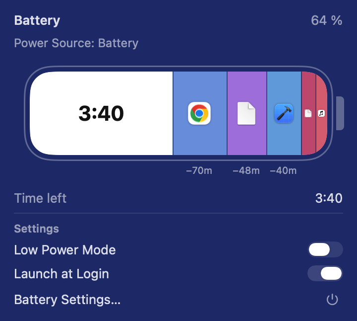
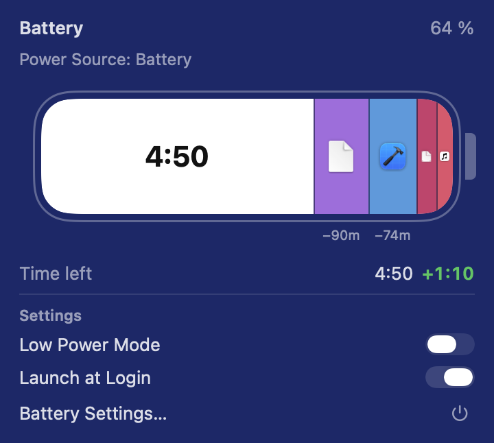

# BatterySegments

**A macOS menu bar battery app that shows which apps are eating your battery time, and lets you quit them by dragging them out of the battery.**

Click the battery icon in the menu bar. One battery-shaped bar shows the time you have left and, as colored slices, how much of it each running app is costing you. Drag a slice out of the popover and drop it: the app quits and the time left goes up.

<a href="docs/promo.mp4"></a>

[Watch the demo with sound](docs/promo.mp4) (23 s). The video is made with Remotion; its source is in [`promo/`](promo).

<p>
  
  
</p>

## Features

- **Per-app battery impact** in one bar: time left on the left, one slice per app on the right, widest drain first.
- **Drag to quit**: pull a slice out of the popover to quit that app. Drop it back inside to cancel.
- **Live estimate**: see `+1:10` of extra battery time before you even let go.
- **Safe**: uses a polite quit only, never force quit. Apps with unsaved work stay open and you get a notice.
- **No dragging needed**: right-click a slice > `Quit …`, or press `⌫` on a focused slice. VoiceOver labels included.
- **Settings in the popover**: Launch at Login and a Low Power Mode switch, plus a small quit button. See [the note below](#low-power-mode-switch) on what the switch installs.
- **Native look**: menu bar icon matches the system battery indicator; Liquid Glass popover on macOS 26+.
- **Stays where you put it**: hold `⌘` and drag the icon to move it in the menu bar; macOS remembers the spot across restarts of the app.
- **Light on battery itself**: samples only while the popover is open.
- No account, no network, no dependencies. SwiftUI + AppKit + IOKit only.

Numbers are **estimates** and will not match Activity Monitor exactly. While plugged in, slices are gray and cannot be dragged.

## Install

Requires macOS 13 (Ventura) or later. Runs on both Apple Silicon and Intel Macs.

1. Download `BatterySegments.dmg` from [Releases](../../releases/latest).
2. Drag `BatterySegments.app` to `Applications` and open it.
3. macOS will say it "could not verify" the app. This is expected: the app is ad-hoc signed and not notarized (no paid Apple Developer account). Click **Done**, then go to **System Settings > Privacy & Security** and click **Open Anyway**.

Or from Terminal:

```bash
xattr -dr com.apple.quarantine /Applications/BatterySegments.app
```

To start it at login: turn on `Launch at Login` under Settings in the popover.

### Low Power Mode switch

macOS only lets an administrator change Low Power Mode. The first time you use the switch, the app asks for your password once and installs `/etc/sudoers.d/batterysegments`. That file lets your user run exactly two commands without a password, and nothing else:

```
/usr/bin/pmset -a lowpowermode 0
/usr/bin/pmset -a lowpowermode 1
```

After that the switch works without asking. The file stays if you delete the app; if you never use the switch, nothing is installed. To remove it:

```bash
sudo rm /etc/sudoers.d/batterysegments
```

## Build from source

Needs Xcode and `brew install xcodegen xcbeautify create-dmg`. Run these from the project folder:

```bash
./scripts/build.sh      # Release build into build/
./scripts/make-dmg.sh   # builds BatterySegments.dmg
xcodegen generate && xcodebuild -scheme BatterySegments test   # unit tests
```

Demo mode (fixed sample data, quitting is simulated, no real app is closed):

```bash
open build/Build/Products/Release/BatterySegments.app --args -demo
```

## How it works

- Battery level, power source and time left come from IOKit power sources. When macOS has no estimate yet (common right after unplugging), the battery gauge's own average is used instead of showing "Calculating…".
- Per-app energy comes from `proc_pid_rusage` billed energy, with helper processes (Chrome, Electron) folded into their app.
- Quitting an app that draws a share `s` of total power turns `t` minutes left into `t / (1 - s)`.

## Türkçe

Menü çubuğundaki pil simgesine tıklayın. Kalan süre ve her uygulamanın bu süreden ne kadar götürdüğü tek bir pil çubuğunda görünür. Bir uygulamanın dilimini pencerenin dışına sürükleyip bırakmak o uygulamayı kapatır. İlk açılıştaki Gatekeeper uyarısı için: **Sistem Ayarları > Gizlilik ve Güvenlik > Yine de Aç**.

## License

[MIT](LICENSE)
